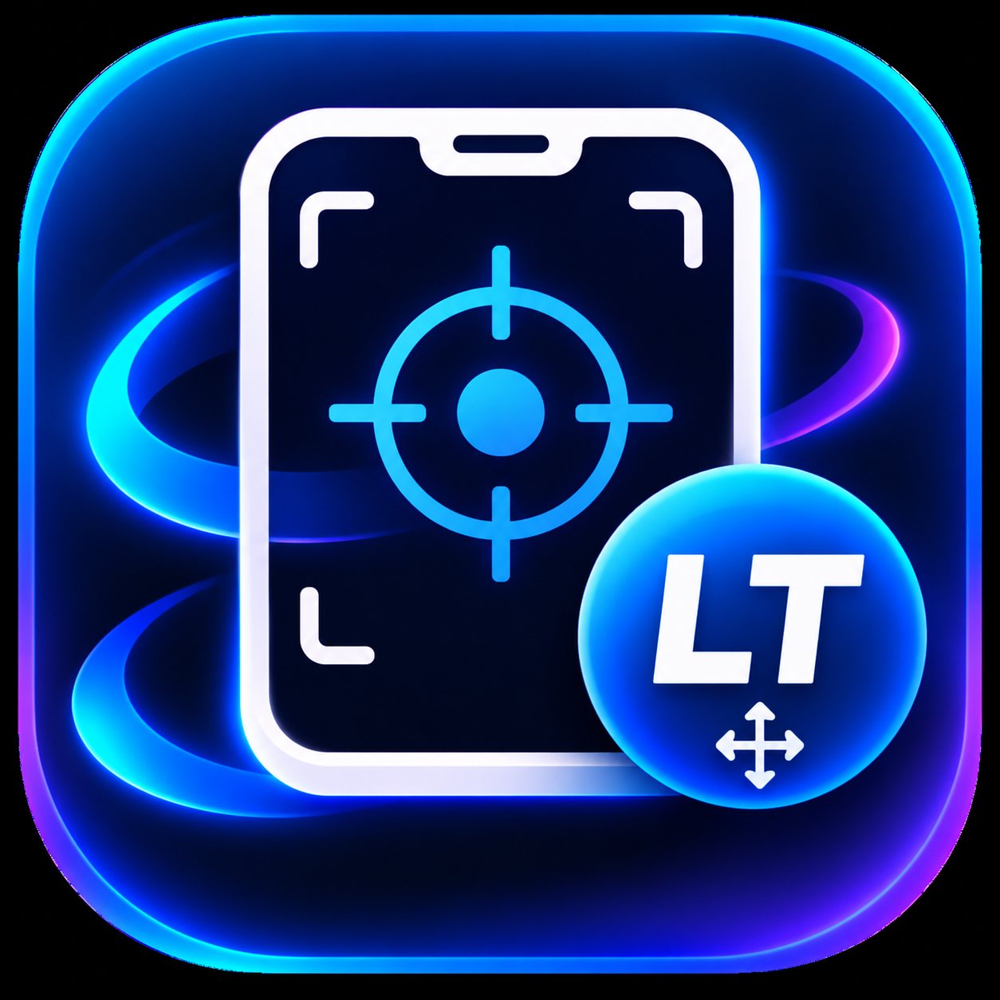

 

  

<h1 align="center">Live UI Tracker</h1>

  <b>Monitor. Identify. Remove Unwanted Apps.</b>

---

Live UI Tracker is an Android application that helps users monitor active applications, browse installed apps, view application details, and manage application removal.

## ✨ Key Features

- **Live App Monitoring** – Detect currently active applications in real time.
- **Floating LT Bubble** – Draggable floating tracker accessible over other applications.
- **Installed Apps Manager** – Browse all installed applications.
- **App Search** – Search by application name or package name.
- **App Filtering** – Filter All Apps, User Apps, and System Apps.
- **App Statistics** – View total, user, and system application counts.
- **Native App Icons** – Display actual application icons directly from Android.
- **App Details** – View package name, version, installation date, and last update.
- **Normal Uninstall** – Use Android's native uninstall confirmation.
- **Force Uninstall (Root)** – Attempt automatic application removal with authorized root access.
- **Root Detection** – Automatically check root availability.
- **Permission Management** – Check required Android permissions.
- **Automatic Refresh** – Keep tracker status and installed application lists updated.

## ⚠️ Root Access Warning

**ROOT USERS ONLY**

Force Uninstall requires a rooted Android device and authorized root access. Removing system applications may affect device functionality or stability.

Non-rooted devices can still use normal Android uninstall.

## ⚠️ Disclaimer & Liability

Live UI Tracker is provided for educational and personal use. Use the application at your own risk.

- Users are responsible for how they use the application and its features.
- Root access and force uninstall operations may cause system errors, data loss, or device instability.
- Removing essential system applications may affect normal device functionality.
- Always understand the consequences before performing application removal.
- The developer is not responsible for device damage, data loss, system issues, or other problems resulting from improper use, misuse, or unauthorized operations.

**By using Live UI Tracker, you acknowledge that you are responsible for your actions and use of the application.**

## 👨‍💻 Developer

**ejlef**

GitHub: [@ejlef](https://github.com/ejlef)

---

⭐ If you like this project, give the repository a star!

**Live UI Tracker — Monitor, Identify, and Manage.**
